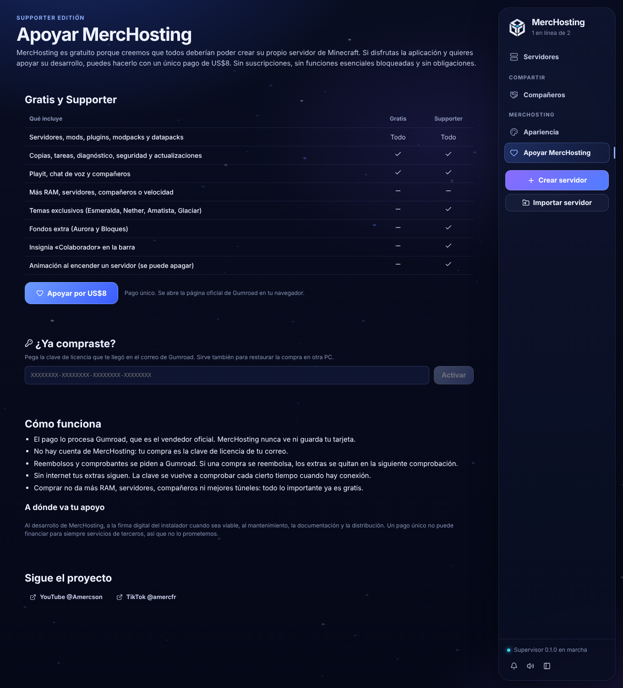
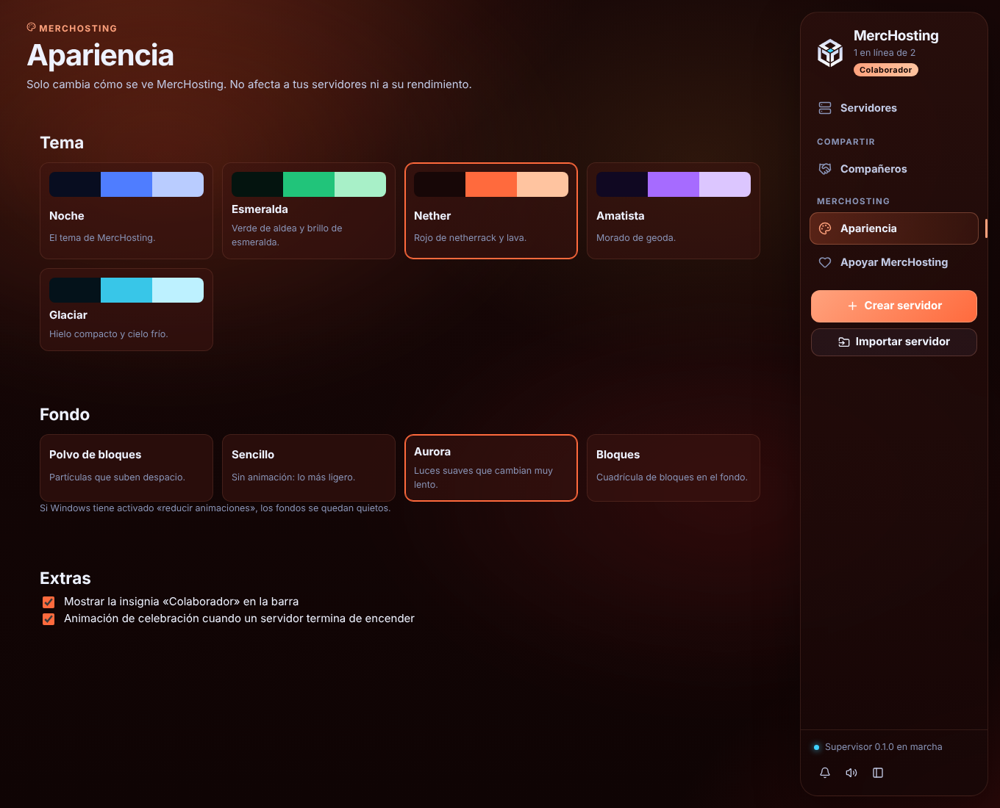

# Fase 10 · incremento 1: Free + Supporter Edition

## Decisión de pagos: Gumroad
Se comparó a fecha 30-10-2026 lo publicado por cada proveedor para un desarrollador en Perú:

| | Gumroad (elegido) | Lemon Squeezy | Paddle |
|---|---|---|---|
| Cobra a Perú | Sí, depósito bancario en soles | Sí, por banco o PayPal | Sí |
| Comisión | ~10 % + US$0,50 (~US$1,30 por venta de US$8) | 5 % + US$0,50 | 5 % + US$0,50 |
| Es el vendedor oficial (impuestos, reembolsos, comprobantes) | Sí | Sí | Sí |
| Comprobar la compra desde la app sin servidor propio | Sí: API pública `/v2/licenses/verify`, informa reembolso, contracargo y disputa | Sí, pero un reembolso hay que desactivarlo a mano | No trae claves de licencia |
| Riesgo | Estable | En 2026 se está pasando a Stripe Managed Payments (Stripe no opera en Perú) | Verificación de empresa |

El propietario eligió **Gumroad**.

### Desvío de la especificación
La especificación habla de cuenta, webhook validado e idempotencia. Por decisión del propietario en la Fase 8 **no hay cuentas ni servidor propio**, así que funciona así:
- La compra es la **clave de licencia** que Gumroad envía por correo. Sirve en cualquier PC y para restaurar la compra.
- No hace falta webhook: la app pregunta a Gumroad por la clave.
- Las revisiones no cambian nada en Gumroad, así que repetirlas no tiene efecto.
- Activar suma un «uso» en Gumroad; revisar no.

## Qué hace la app
- **Comprar**: «Apoyar por US$8» abre la página oficial de Gumroad en el navegador. MercHosting **no ve ni guarda datos de pago**. Nunca hay compras simuladas.
- **Activar o restaurar**: se pega la clave y el supervisor la comprueba con Gumroad, usando el ID del producto.
  - Se rechazan las claves inventadas, de otro producto, reembolsadas, con contracargo o con disputa perdida.
  - En esta PC (`supporter.json`) se guardan la clave, el correo oculto (`a•••@gmail.com`) y la fecha.
- **Revisión**: si pasaron más de 7 días, al abrir la app se revisa en segundo plano. También hay «Comprobar ahora».
  - Un reembolso o contracargo apaga los extras.
  - **Sin red o con Gumroad caído no se quita nada**: se conserva el último estado y se anota el problema.
- **Quitar de esta PC**: borra la clave guardada.
- Activar, restaurar, revocar y quitar quedan en la Actividad, solo con los 4 últimos caracteres de la clave.
- Compañeros: nada de Supporter está permitido a distancia (se deniega por defecto).
- **Mientras no exista el producto en Gumroad**, el botón dice «Próximamente», está desactivado y no se puede activar nada. MercHosting sigue completo.

## Beneficios (solo cosméticos)

- **Temas exclusivos**: Esmeralda, Nether, Amatista y Glaciar. Tiñen fondo, barra, selección y botones.
- **Fondos extra**: Aurora (animado, muy lento) y Bloques.
- **Insignia «Colaborador»** en la barra. Se puede ocultar.
- **Celebración** breve cuando un servidor termina de encender. Se puede apagar.
- No da más RAM, servidores, compañeros ni mejores túneles. La tabla «Gratis y Supporter» lo dice explícitamente.
- Gratis tiene el tema Noche y elige fondo: polvo de bloques o **sencillo** (sin animación, lo más ligero).
- Con «reducir animaciones» de Windows, los fondos se quedan quietos y no hay celebración.
- Si Supporter deja de estar activo, todo vuelve solo a lo gratuito.

## Transparencia y redes
- Se explica a dónde va el apoyo: desarrollo, firma digital cuando sea viable, mantenimiento, documentación y distribución. No se promete financiar servicios de terceros para siempre.
- Botones a **YouTube @Amercson** y **TikTok @amercfr** (enlaces reales dados por el propietario). Se abren en el navegador.
- La lista de direcciones que la app puede abrir solo suma esas dos y `gumroad.com`.

## Lo que falta configurar (propietario)
1. Crear en Gumroad el producto «MercHosting Supporter Edition»:
   - US$8, pago único;
   - activar **«Generate a unique license key per sale»**.
2. Copiar dos datos en `crates/merc-supervisord/src/supporter.rs`:
   - el **ID del producto** (`GUMROAD_PRODUCT_ID`). Está en la sección de clave de licencia del producto. No es secreto.
   - la **dirección de compra** (`CHECKOUT_URL`).
3. Reembolsos: se hacen en Gumroad. La app los detecta sola en la siguiente revisión.

## Pendiente para el incremento 2
- Iconos alternativos de la aplicación.
- Créditos de agradecimiento con consentimiento (nombre público aprobado).
- Modo claro para todos.

Las votaciones de estética necesitan un servicio en línea. No se hacen sin servidor: no se ponen botones que no funcionen.

## Pruebas
- **Rust**: interpretación de respuestas (válida, reembolso, contracargo, disputa ganada o perdida, clave inexistente, otro producto) y formato de clave.
- **Rust, de punta a punta** con el supervisor real y un Gumroad falso:
  - sin producto no se puede activar;
  - clave inventada rechazada;
  - clave real activada (con espacios al pegar) y doble activación;
  - reiniciar y revisar sin red conserva el estado;
  - el reembolso apaga los extras sin sumar usos;
  - la misma clave funciona en otra PC y «Quitar» la borra.
- **Interfaz**:
  - comparador honesto;
  - abrir la página de compra;
  - clave mala y clave buena;
  - insignia;
  - redes;
  - «Próximamente»;
  - el reembolso devuelve el tema gratuito;
  - candados en Apariencia;
  - fondo sencillo sin partículas;
  - celebración al encender.
