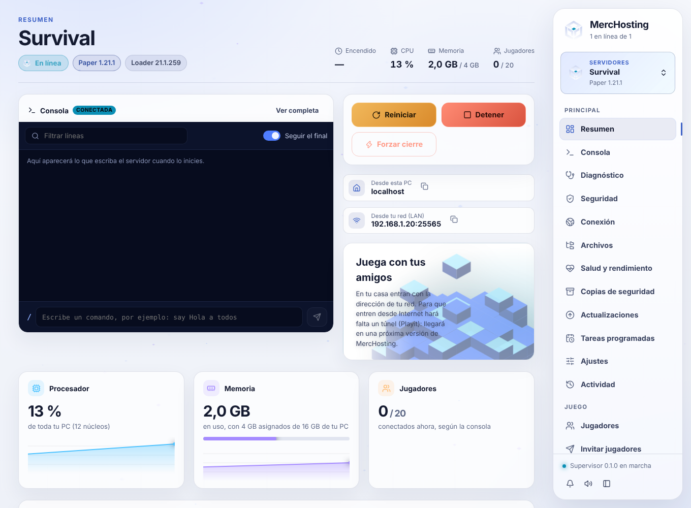
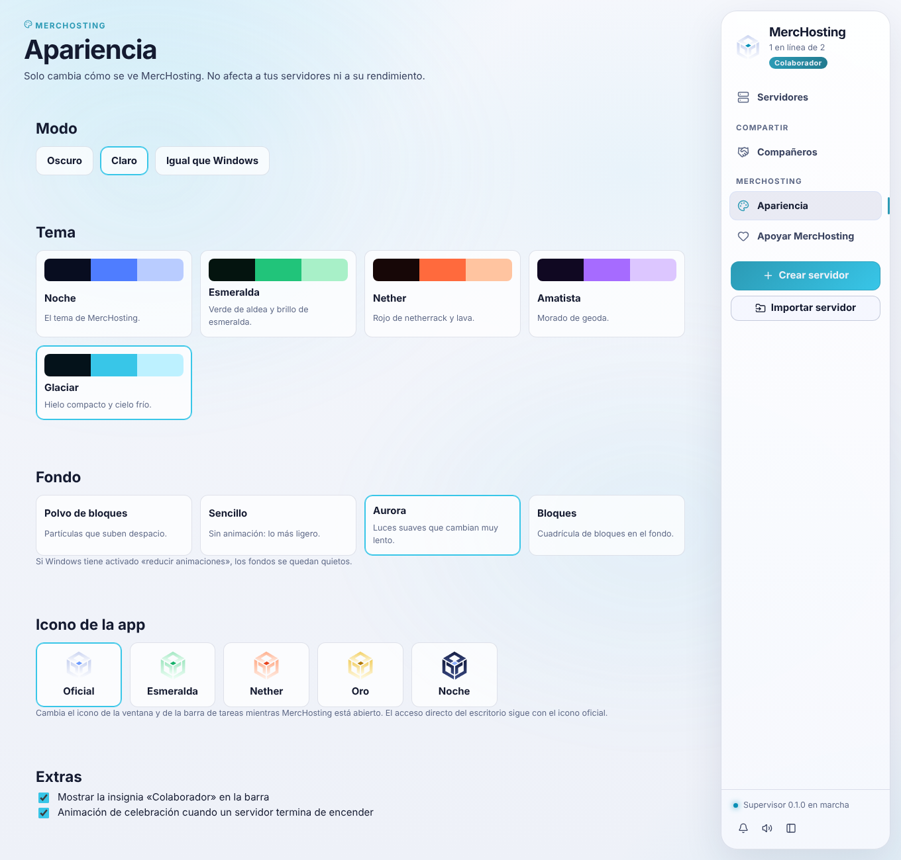

# Fase 10 · incremento 2: modo claro, iconos alternativos y créditos

## Modo claro (para todos)
- En Apariencia › Modo hay tres opciones:
  - **Oscuro**;
  - **Claro**;
  - **Igual que Windows**, que cambia en cuanto cambia Windows.
- Los temas de Supporter también funcionan en claro: conservan su color de acento.
- La consola se queda oscura, como una terminal, y la vista previa del MOTD también.

**Cómo se hace.** El estilo se diseñó en oscuro y tiene unos 240 colores escritos a mano. En vez de mantener dos hojas a mano, `scripts/generar-modo-claro.mjs` lee `styles.css` y escribe `app/src/light.css`. Para cada color de fondo, borde, texto o sombra pone su equivalente claro:
- las superficies oscuras pasan a blancas;
- los velos azulados, a sombras suaves;
- el texto claro, a tinta oscura;
- los acentos se oscurecen para leerse sobre blanco.

Una prueba falla si `light.css` no corresponde al `styles.css` actual. Así el modo claro no se queda atrás cuando cambia el estilo. Después de tocar `styles.css` hay que ejecutar `node scripts/generar-modo-claro.mjs`.

## Iconos alternativos (Supporter)

- El mismo logo de MercHosting en otros colores: Oficial, Esmeralda, Nether, Oro y Noche.
- Cambian el icono de la **ventana y de la barra de tareas** mientras la app está abierta. El texto de la app lo dice: el acceso directo y el instalador mantienen el oficial, porque cambiarlos haría falta modificar archivos de Windows.
- Si Supporter deja de estar activo, vuelve el icono oficial.
- Técnica: el logo se dibuja como PNG de 256 px y se pasa a `setIcon` de la ventana. Se añadieron los permisos `core:window:allow-set-icon` y `core:app:allow-default-window-icon` y la función `image-png` de Tauri.

## Créditos con consentimiento
- La página «Apoyar MercHosting» tiene «Gracias a». Solo muestra los nombres de `app/src/supporterCredits.json`, que está vacío.
- Sin servidor no hay lista automática. El propietario:
  1. añade en Gumroad (producto › campos personalizados) un campo **opcional**, por ejemplo «Nombre público para los créditos (opcional)»;
  2. al preparar una versión, copia a `supporterCredits.json` los nombres que la gente escribió;
  3. quita a quien pidió reembolso o pidió salir.
- Si el campo se deja vacío, no se publica nada. Los nombres se muestran como texto, sin enlaces.

## Lo que no se hace
- **Votaciones de estética**: necesitan un servicio en línea para contar los votos y no hay servidor. No se ponen botones que no funcionen.
- **Marcos de avatar y fondos de perfil**: no hay perfiles, porque no hay cuentas.

## Pruebas
- **Interfaz**:
  - modo claro y oscuro, y que se recuerdan;
  - iconos con candado sin Supporter;
  - con Supporter el icono cambia de verdad (llega el SVG con el color de la variante);
  - un reembolso devuelve el icono oficial;
  - créditos vacíos con su explicación;
  - `light.css` al día.
- Hay capturas en claro y en oscuro de varias pantallas.
