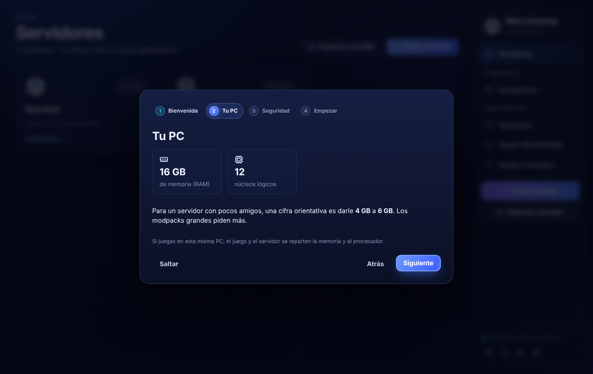
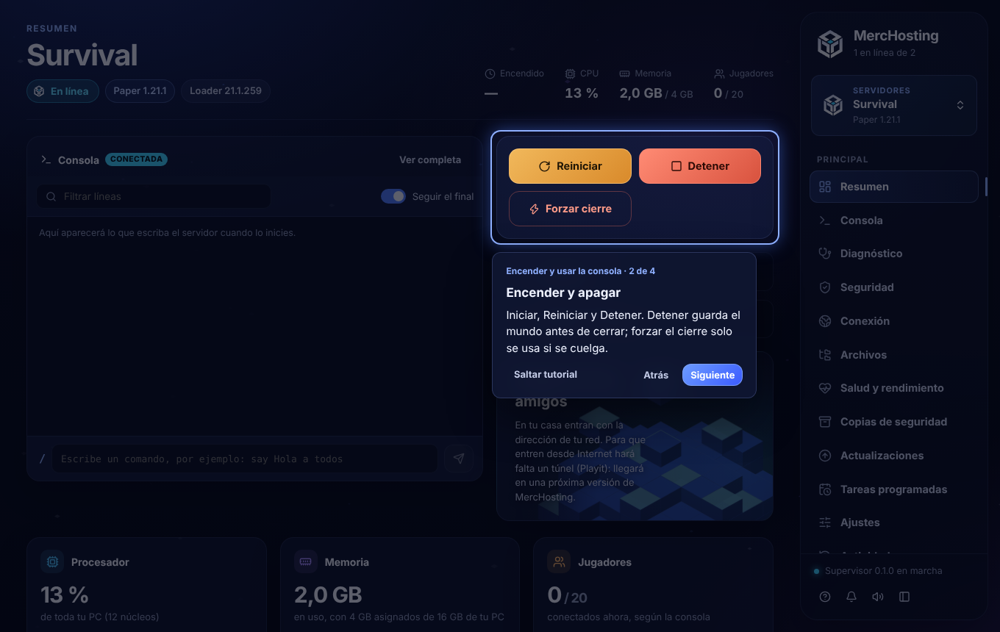

# Fase 2: bienvenida, tutoriales y modo principiante

## Bienvenida del primer inicio
Cuatro pasos. Se puede **saltar** en cualquiera y repetir desde Ayuda.
1. **Qué es MercHosting**: tu PC es el servidor y debe estar encendida. No es un hosting en la nube.
2. **Tu PC**: memoria y núcleos **reales**, leídos del supervisor.
   - Da una cifra orientativa de memoria para un servidor (por ejemplo, 4–6 GB si la PC tiene 16 GB).
   - Avisa si la PC tiene menos de 8 GB.
   - Recuerda que jugar en la misma PC reparte los recursos.
3. **Seguridad**:
   - la EULA la aceptas tú;
   - los mods son código que se ejecuta en tu PC;
   - online-mode y lista blanca;
   - compañeros, solo de confianza;
   - nunca se piden contraseñas.
4. **Modo**: principiante o avanzado, con «Ver el tutorial» o «Empezar sin tutorial».

## Tutoriales

Cada paso **resalta un control real** de la app: el resto de la pantalla se oscurece y queda bloqueado. Si hace falta, el tutorial lleva a la pantalla correcta (abre el servidor y la pestaña). Algunos pasos **avanzan cuando haces la acción**: por ejemplo, hacer clic en «Crear servidor».
- Esc sale y Enter avanza. También están los botones «Atrás», «Siguiente» y «Saltar tutorial».
- Si un control no está a la vista (depende del estado del servidor), el paso lo dice en vez de inventar.

Tutoriales disponibles:
- primeros pasos;
- crear tu primer servidor;
- encender y usar la consola;
- que tus amigos entren (red local y Playit);
- chat de voz;
- mods y plugins;
- copias de seguridad;
- compañeros y permisos.

Los tutoriales de un servidor se desactivan, con explicación, si todavía no hay ninguno.

## Ayuda y tutoriales
Está en la barra y en el botón «?» del pie, visible en todas las pantallas. Contiene:
- la lista de tutoriales y «Ver la bienvenida otra vez»;
- el cambio de modo;
- preguntas frecuentes: amigos que no entran, por qué la PC debe estar encendida, cuánta memoria dar, la EULA, si los mods son seguros, el servidor que se cierra al arrancar y qué pasa al cerrar MercHosting.

## Modo principiante / avanzado
Es la misma app y la misma lógica. El principiante solo **oculta** estas pestañas: Archivos, Tareas programadas, Salud, Actividad, Seguridad, Mundos, Datapacks y LuckPerms. Ayuda dice cuáles están ocultas. No se borra ni se desactiva nada. Si la pestaña abierta deja de estar visible, se vuelve al Resumen.

## Corrección
La tarjeta «Juega con tus amigos» del Resumen todavía decía que Playit «llegará en una próxima versión». Ahora lleva a Conexión.

## Pruebas (interfaz)
- Bienvenida: datos reales de la PC, modo guardado, no se repite y «Saltar».
- El tutorial recorre controles reales y Esc sale.
- «Crear servidor» avanza con el clic de verdad y abre el asistente.
- Los tutoriales de un servidor abren su pestaña; sin servidor están desactivados.
- El modo principiante oculta pestañas y se cambia desde Ayuda.
