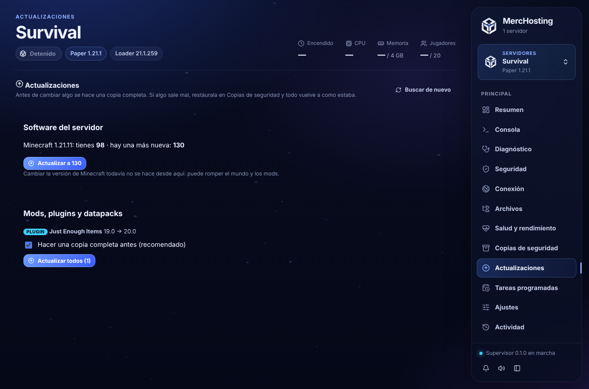
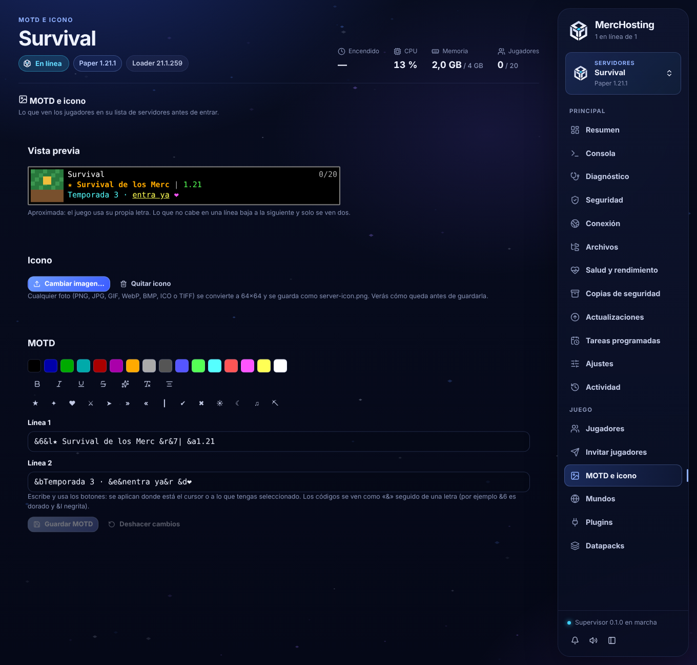

# Fase 9 · incremento 4: Centro de actualizaciones, y MOTD e icono

## Centro de actualizaciones (pestaña «Actualizaciones»)
Antes de cambiar nada se hace una **copia completa comprobada**. Volver atrás es restaurar esa copia en Copias de seguridad, que aparece con el motivo «Antes de actualizar». Al terminar hay un botón directo para ir.

### Software del servidor
- **Paper y Purpur**: compilación más nueva de la misma versión de Minecraft. **Fabric**: versión más nueva del loader. Se usan las mismas fuentes oficiales que al crear el servidor.
- Las versiones se comparan por números (`0.16.10` es más nueva que `0.16.9`; la compilación `130` es más nueva que `98`).
- Pasos del trabajo (con progreso; solo con el servidor detenido):
  1. Se vuelve a pedir la versión a la fuente oficial. Si ya no es la que viste, no se hace nada.
  2. Se hace la copia completa. Si falla, no se toca nada.
  3. Se descarga el archivo nuevo y se comprueba su huella.
  4. El servidor pasa a arrancar con el archivo nuevo y se guarda la versión nueva.
  5. El archivo anterior va a la papelera de MercHosting.
  6. Queda anotado en la Actividad con el número de la copia previa.
- **Forge, NeoForge y Quilt** se actualizan con su instalador oficial, que reescribe librerías y scripts. **Spigot** se compila con BuildTools. **Vanilla** solo cambia con la versión de Minecraft. Para todos estos la pestaña explica por qué no se ofrece todavía, en vez de mostrar un botón que no funciona.
- **Cambiar la versión de Minecraft** no se ofrece: puede romper el mundo y los mods.
- Compañeros: pueden ver si hay versión nueva. Aplicarla es solo del dueño (se deniega por defecto).

### Mods, plugins y datapacks
- Se juntan todos los que tienen versión nueva (de Modrinth, CurseForge o Hangar) y se pueden actualizar de una vez con **«Actualizar todos»**.
- La casilla «Hacer una copia completa antes» viene marcada.
- Cada uno pasa por el mismo plan que la instalación normal. Si tiene un bloqueo, se salta y se dice por qué. Las versiones viejas van a la papelera de MercHosting.
- Actualizar uno solo sigue estando en su pestaña.

## MOTD e icono (pestaña «MOTD e icono», en Juego)

### Icono
- Se elige **cualquier imagen**: PNG, JPG, GIF, WebP, BMP, ICO o TIFF. Máximo 25 MB y 12 000 píxeles por lado.
- Se convierte en **PNG de 64×64** (lo único que Minecraft muestra) y se guarda como `server-icon.png`.
- Antes de guardar se ve el resultado. Se puede elegir entre **recortar al centro** o **imagen completa con bordes transparentes**.
- Las imágenes pequeñas, como el pixel art, se agrandan sin difuminar. Las grandes se reducen con un filtro de calidad (Lanczos).
- El icono anterior **va a la papelera de MercHosting**, nunca se borra. El archivo nuevo se escribe aparte y luego se cambia, así nunca queda a medias.
- Si el `server-icon.png` actual no mide 64×64 o no es PNG, se avisa que Minecraft no lo mostrará.
- Para compañeros es solo de lectura, porque la imagen se elige de archivos de la PC del dueño.

### Editor de MOTD
- **Colores**: los 16 colores oficiales, como muestras clicables.
- **Formato**: negrita, cursiva, subrayado, tachado, ofuscado (letras que cambian) y quitar formato.
- **Extras**: centrar la línea y símbolos (★ ❤ ⚔ » …).
- Los botones se aplican donde está el cursor. Si hay texto seleccionado, se aplican **solo a lo seleccionado** y después vuelve el estilo que había.
- En el editor los códigos se ven como `&` más una letra (por ejemplo `&6` es dorado). Se guardan con `§` en `server.properties`, que es lo que lee el servidor. El archivo se escribe con escapes `§` y `\n`, que entiende cualquier versión.
- Tiene **dos líneas**. `server.properties` ahora acepta un salto de línea solo en `motd`; el resto de opciones sigue sin aceptarlos.
- **Vista previa en vivo** como en la lista de servidores:
  - icono;
  - nombre;
  - jugadores conectados de verdad y máximo de `server.properties`;
  - el texto cortado a 271 píxeles del juego, igual que hace Minecraft. Solo se ven dos líneas y, si algo queda fuera, se avisa.
- La vista previa es aproximada: no se incluye la letra de Minecraft.
- **Colores hex**: no se ofrecen. Desde `server.properties` el juego solo entiende los 16 colores; los colores hex necesitan un plugin de MOTD.
- El campo de texto del MOTD sale de Ajustes, porque allí no cabían los colores ni las dos líneas.
- Guardar usa el mismo control de cambios externos que Ajustes y crea una copia previa del archivo.

## Pruebas
- **Rust**:
  - conversión de PNG, JPG, BMP y GIF a 64×64;
  - recorte frente a imagen completa;
  - basura rechazada;
  - MOTD de dos líneas ida y vuelta;
  - comparación de versiones;
  - de punta a punta con el supervisor real: crear un Paper y encenderlo, detectar la compilación 50, rechazar una versión distinta de la ofrecida, actualizar con copia «Antes de actualizar» (el jar viejo va a la papelera), y foto JPG convertida a server-icon.png de 64×64, reemplazada y quitada.
- **Interfaz**:
  - editor con botones, vista previa y guardado con `§` y salto de línea;
  - icono con vista previa, cambio de encaje, guardado y quitar;
  - error con un archivo que no es imagen;
  - actualizar el servidor y volver atrás;
  - tipo no compatible;
  - actualizar todos con copia previa.
